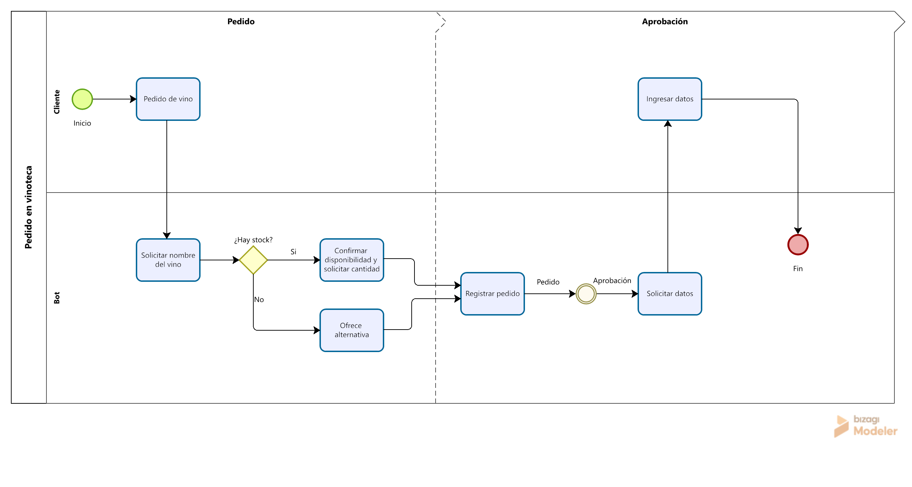

# VinosBot 🍷

Chatbot de Telegram desarrollado en Java para automatizar la consulta de stock y la toma de pedidos de **El Tonel**, la vinoteca de mi familia.

> 🚧 Proyecto en desarrollo. Surgió como trabajo para la Tecnicatura Universitaria en Programación (UTN) y lo estoy extendiendo para usarlo en el negocio.

## 🎥 Demo

[GIF o link al video del bot funcionando en Telegram]

## 📌 Problema que resuelve

Las consultas de stock y los pedidos se atendían a mano por mensaje. El bot permite que el cliente busque vinos, vea qué hay disponible y deje su pedido sin intervención manual.

## 🧩 Funcionalidades

- Búsqueda de vinos por **nombre** o **bodega**.
- Listado de vinos **disponibles** y **agotados**.
- Validación de stock al pedir una cantidad de botellas.
- Registro de pedidos con datos del cliente (nombre y teléfono).
- Descuento de stock al confirmar el pedido.
- Conversación guiada mediante una máquina de estados por usuario (`chatId`).

## 🛠️ Tecnologías

- Java 25
- [TelegramBots](https://github.com/rubenlagus/TelegramBots) 6.9 (long polling)
- Apache POI 5.5 (lectura de Excel)
- NetBeans + Apache Ant
- Modelado del proceso con BPMN 2.0

## 🗂️ Estructura

```
src/vinoseltonelbot/
├── Main.java           → punto de entrada: registra y arranca el bot
├── VinosBot.java       → lógica del bot y manejo de estados de la conversación
├── GestorVinos.java    → carga los vinos desde Excel y resuelve las búsquedas
├── GestorPedidos.java  → registra pedidos y actualiza el stock
├── Vino.java           → modelo: id, nombre, bodega, precio, stock
└── Pedido.java         → modelo: vino, cantidad, cliente, teléfono
datos/vinos.xlsx        → catálogo de productos
```

## 📊 Diagrama BPMN



## 🚀 Cómo ejecutarlo

**Requisitos:** JDK 25 y NetBeans (o cualquier IDE con soporte para proyectos Ant).

1. Clonar el repositorio:
   ```
   git clone https://github.com/facundopeli/vinos-bot.git
   ```
2. Crear un bot con [@BotFather](https://t.me/BotFather) y copiar el token.
3. Configurar el token como variable de entorno:
   - Windows: `setx TELEGRAM_BOT_TOKEN "tu_token"` (después reiniciar la terminal o el IDE)
   - Linux/Mac: `export TELEGRAM_BOT_TOKEN="tu_token"`
4. Revisar el catálogo en `datos/vinos.xlsx`. La primera hoja debe tener las columnas `ID | VINO | BODEGA | PRECIO | STOCK`.
5. Abrir el proyecto en NetBeans y ejecutar `Main`.
6. Escribirle al bot desde Telegram.

## 📍 Estado actual y próximos pasos

- [x] Búsqueda por nombre y bodega, consulta de stock
- [x] Flujo conversacional para tomar pedidos
- [x] Lectura del catálogo desde Excel
- [ ] Persistir pedidos y stock (hoy se mantienen en memoria)
- [ ] Migrar la persistencia a una base de datos [MySQL / MongoDB]
- [ ] Puesta en funcionamiento en El Tonel

## 👤 Autor

Facundo Pelizzari: [LinkedIn](https://linkedin.com/in/facundopelizzari-dev) · [GitHub](https://github.com/facundopeli)
